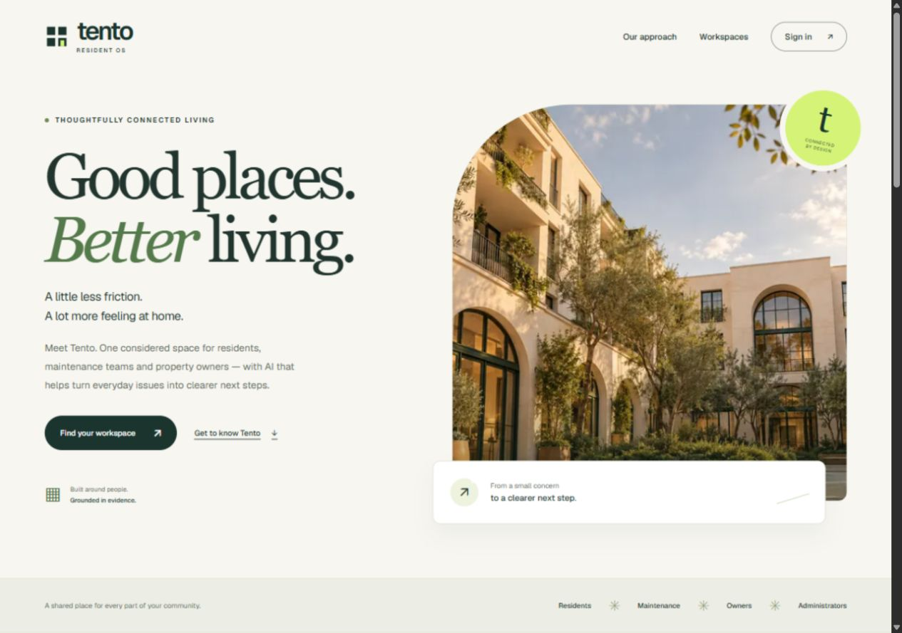
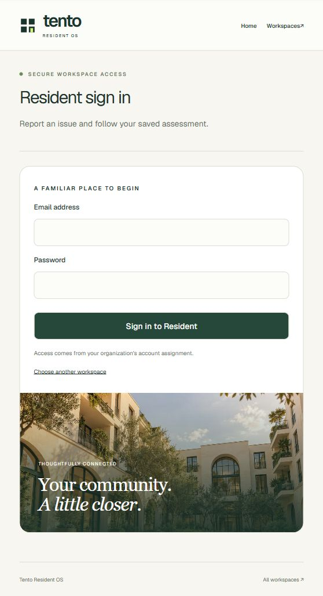
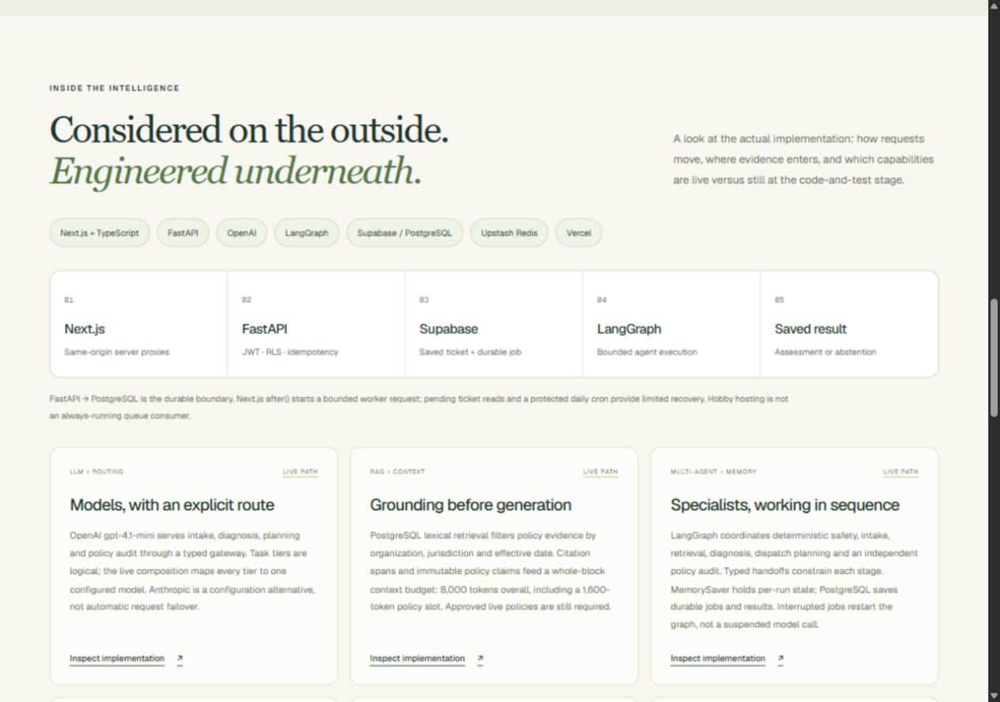
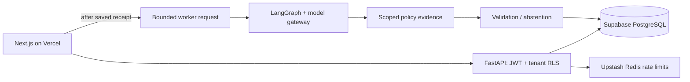

# Tento Resident OS

**[Live application](https://tento-resident-os.vercel.app/)** · [Engineering showcase](https://tento-resident-os.vercel.app/#engineering) · [Resume bullets](#resume-ready-project-bullets) · [Local setup](#local-development)

An AI-assisted maintenance platform connecting residents, maintenance teams, property owners and technical administrators. Tento turns a resident's report into a saved, traceable assessment through a tenant-scoped agent workflow.

## Project parts

**Part 1 — deployed MVP:** authenticated reporting, four workspaces and autonomous maintenance assessment. **Part 2A — measurement and caching:** configurable model tiers, temperature controls, provider first-content timing, token-price estimates and tenant-scoped Upstash embedding reuse. [Implementation, measured results and next gates](docs/PART-2-GENAI.md).

## Product experience

Residents sign in, select an authorized residence, submit a report and follow its assessment. Staff workspaces display organization-scoped requests, agent outcomes and service readiness. The API verifies account roles and tenant membership for every protected request.

| Workspace | Entry point |
| --- | --- |
| Resident | [Report and track maintenance](https://tento-resident-os.vercel.app/sign-in?workspace=resident) |
| Maintenance | [Organization request queue](https://tento-resident-os.vercel.app/sign-in?workspace=maintenance) |
| Owner | [Maintenance overview](https://tento-resident-os.vercel.app/sign-in?workspace=owner) |
| Technical administrator | [Application operations](https://tento-resident-os.vercel.app/sign-in?workspace=admin) |

**MVP scope:** staff workspaces are read-only. Policy-backed work orders require approved property evidence; the workflow returns an explicit abstention when evidence is insufficient.

## Application screenshots

| Main application | Workspace sign-in |
| --- | --- |
| [](https://tento-resident-os.vercel.app/) | [](https://tento-resident-os.vercel.app/sign-in?workspace=resident) |

<details>
<summary>Engineering showcase</summary>

[](https://tento-resident-os.vercel.app/#engineering)

</details>

Screenshots show the deployed application with no account credentials. The courtyard artwork is an original conceptual brand image. [Visual identity guide](docs/BRAND.md).

## Engineering highlights

- **Multi-agent orchestration:** LangGraph coordinates safety screening, intake, source retrieval, diagnosis, dispatch planning and independent policy validation through typed handoffs.
- **LLM gateway:** OpenAI **gpt-4.1-mini** serves four specialist model stages, with task routing, JSON-object output, Pydantic validation, bounded retries and prompt-version receipts.
- **Evidence-grounded retrieval:** PostgreSQL full-text ranking scopes policy sources by organization, jurisdiction and effective date, preserving exact citation spans and canonical policy claims.
- **Context engineering:** an **8,000-token** application envelope uses tokenizer-backed allocation and whole-block policy selection to preserve source integrity.
- **Execution state:** per-run LangGraph checkpoints coordinate agent state; PostgreSQL persists jobs, steps, traces and results for subsequent reads and retry recovery.
- **Durable processing:** tickets and jobs commit together before assessment. Fenced leases, bounded attempts and deterministic work-order identities protect retries and state transitions.
- **Tenant security:** Supabase signed authentication, server-verified roles, explicit organization predicates, transaction-local PostgreSQL RLS and separate API/worker logins enforce access boundaries.
- **AI guardrails:** deterministic safety rules, PII redaction, local injection screening, typed untrusted context and schema/evidence validation constrain model-driven decisions.
- **Request protection:** Upstash Redis rate limits, PostgreSQL idempotency receipts, HttpOnly/Secure cookies and same-origin mutation checks protect the browser-to-API boundary.
- **Evaluation and observability:** versioned retrieval, injection and fair-housing fixtures accompany automated tests; model receipts record prompt versions, token usage, elapsed latency and outcomes.

### Model routing

| Specialist stage | Logical tier | Production model |
| --- | --- | --- |
| Intake normalization | Small | gpt-4.1-mini |
| Diagnosis | Mid | gpt-4.1-mini |
| Dispatch planning | Mid | gpt-4.1-mini |
| Policy audit | Small | gpt-4.1-mini |

The current deployment uses temperature 0 and maps these logical tiers to GPT-4.1-mini. Server-owned tier overrides allow independently configured models; the gateway records the selected model and generation settings. [Gateway implementation](services/brain/src/brain/gateway/client.py) · [Production composition](services/brain/src/brain/production.py).

## Architecture



Ticket creation, job enqueueing and the idempotency receipt share a transaction. Next.js after() initiates a tenant-authorized processing request. The worker claims a fenced lease, executes the graph and commits its result while the lease remains valid. Pending detail reads and protected daily recovery can reclaim eligible interrupted work.

Production uses a 15-second gateway-call timeout, a 1,024-output-token route default, a 12-step graph cap and a 180-second workflow execution timeout. Jobs have at most three attempts and a 300-second fencing lease. These values describe execution controls.

[Architecture and source-linked engineering notes](docs/ENGINEERING.md) · [Deployment and recovery](docs/DEPLOYMENT.md).

## Technology stack

| Layer | Technology | Responsibility |
| --- | --- | --- |
| Application | Next.js, React, TypeScript, Tailwind CSS | Branded portal, role workspaces and server proxies |
| API | FastAPI, Python, Pydantic | Typed contracts, verified identity and request controls |
| Agent runtime | LangGraph, OpenAI gpt-4.1-mini | Typed orchestration and structured model generation |
| Data and identity | Supabase PostgreSQL, Supabase Auth | Tenant records, durable jobs, audit receipts and signed identity |
| Rate limiting and embedding reuse | Upstash Redis over TLS | Request budgets and tenant-scoped verified-source embedding cache |
| Quality | pytest, Ruff, mypy, TypeScript, GitHub Actions | Unit, contract, database and web quality gates |
| Hosting | Vercel | Frontend and bounded Python API/worker execution |

## Resume-ready project bullets

**Tento Resident OS | Full-stack Generative AI Project**

- **Built and deployed** a multi-tenant GenAI maintenance platform with **Next.js, FastAPI, OpenAI GPT-4.1-mini and Supabase**, supporting **four role-based workspaces** with server-verified access and organization-scoped data.
- **Orchestrated four specialist LLM stages with LangGraph**, combining typed handoffs, deterministic safety screening and independent policy validation to produce traceable assessments and explicit evidence-based abstention.
- **Engineered a tenant-scoped RAG workflow** using PostgreSQL full-text retrieval, effective-date and jurisdiction filters, exact citation spans and an **8,000-token context budget** to ground maintenance reasoning in applicable sources.
- **Implemented durable asynchronous processing** with atomic ticket/job creation, idempotency receipts, fenced PostgreSQL leases and bounded retries, decoupling saved request receipts from long-running agent execution.
- **Hardened the AI and API boundaries** with PII redaction, prompt-injection screening, Supabase JWT verification, PostgreSQL RLS and Upstash rate limiting; validated workflows through **348 passing Python tests**, PostgreSQL integration and automated web contract checks.

### Measured GenAI engineering

- **Instrumented and benchmarked GPT-4.1-mini intake** across **30 synthetic runs (six unique reports)**, measuring **0.876s p95 intake latency**, **0.562s p95 provider first-content latency** and **$0.000325 estimated token cost per run**.
- **Implemented a tenant-isolated Upstash embedding cache**, reducing warm lookup p95 by **96.0% (320.4ms to 12.8ms)** and avoiding **20 repeat provider calls** in a **20-pair synthetic OpenAI/Redis benchmark**.

These are local synthetic benchmarks; the slowest intake run was **9.734s**. [Sample scope, raw reports and reproduction](docs/PART-2-GENAI.md).

## Local development

Use Python 3.12, Node.js 22 and pnpm 11.19.0. Install requirements.txt and run pnpm install --frozen-lockfile. Configure ignored API and web environment files from .env.example. [Account/key setup](docs/KEYS-AND-SETUP.md).

For a fresh local database, follow the explicit migration/runtime-role steps in [DEPLOYMENT.md](docs/DEPLOYMENT.md). Existing configured installations should retain their data and migration ledger.

```powershell
$env:PYTHONPATH="services/api/src;services/brain/src"
python -m uvicorn api.main:app --env-file .env --reload --port 8000
```

Configure apps/web/.env.local with API_BASE_URL, SUPABASE_URL and SUPABASE_ANON_KEY, then run pnpm dev:web. The web application starts processing after saving a ticket. An optional continuous worker can run separately with WORKER_DATABASE_URL and WORKER_ORG_ID:

```powershell
python -m api.worker
```

## Verification

```powershell
python -m ruff check services/api services/brain infra/seed scripts/export_openapi.py
python -m ruff format --check services/api services/brain infra/seed
python -m mypy
python -m pytest -q
python scripts/export_openapi.py
pnpm generate:api
pnpm typecheck:web
pnpm build:web
python apps/web/scripts/check-proxies.py
python scripts/check_deployment.py
```

Database integration tests require a migrated disposable *_test database through TEST_DATABASE_URL; otherwise they skip. CI runs a dedicated pgvector/PostgreSQL integration job. The web contract suite uses isolated upstream fixtures. Production health checks run through the scheduled repository workflow.

## Project documentation

- [Product and role capabilities](docs/PRODUCT.md)
- [Engineering implementation notes](docs/ENGINEERING.md)
- [Runtime architecture](docs/TECHNICAL-ARCHITECTURE.md)
- [Deployment and recovery](docs/DEPLOYMENT.md)
- [Verified release status](docs/RELEASE-STATUS.md)

[License](LICENSE).
