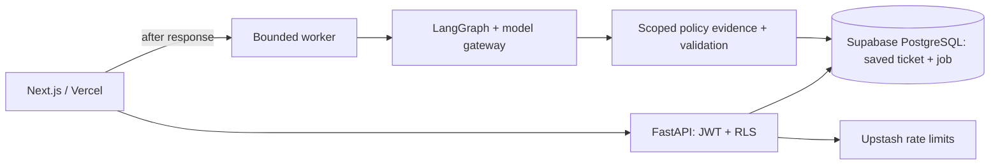

# Tento Resident OS

**[Open the live application on Vercel](https://tento-resident-os.vercel.app/)**

[Screenshots](#application-preview) · [Engineering](#engineering-at-a-glance) · [Local setup](#local-workflow) · [Verification](#verify)

One application for residents, maintenance teams, property owners and technical administrators, powered by an evidence-backed GenAI maintenance workflow.

| Workspace | Live entry |
| --- | --- |
| Resident | [Resident sign in](https://tento-resident-os.vercel.app/sign-in?workspace=resident) |
| Maintenance | [Maintenance sign in](https://tento-resident-os.vercel.app/sign-in?workspace=maintenance) |
| Owner | [Owner sign in](https://tento-resident-os.vercel.app/sign-in?workspace=owner) |
| Technical administrator | [Administrator sign in](https://tento-resident-os.vercel.app/sign-in?workspace=admin) |

Use an existing organization account with the appropriate role. Maintenance, owner and administrator views are currently read-only. Approved property policies are required for policy-backed work orders; missing evidence produces a safe abstention.

Tento Resident OS has one main page with Resident, Maintenance, Owner and Technical administrator workspaces. Maintenance/owner/admin provide verified, read-only operational views; role selection never grants access. The connected maintenance flow lets a resident sign in, select an authorised residence, save a report, and follow its actual status. A separate durable Python worker runs safety, intake, source retrieval, diagnosis, dispatch planning and policy validation. A validated in-house plan creates a real internal work order. No vendor is contacted and no visit is claimed to be scheduled.

## Application preview

| Main application | Workspace sign-in |
| --- | --- |
| [](https://tento-resident-os.vercel.app/) | [](https://tento-resident-os.vercel.app/sign-in?workspace=resident) |

These are screenshots of the deployed application, with no account credentials shown. The courtyard artwork is an original conceptual brand image, not a property listing.

The shared visual identity covers the home page, sign-in, resident flows and staff workspaces. See the [brand guide](docs/BRAND.md) for the palette, typography, imagery and interaction rules.

## Engineering at a glance

The live system combines a Next.js/TypeScript frontend, FastAPI, LangGraph, OpenAI, Supabase PostgreSQL/Auth and Upstash Redis. The inventory below separates the deployed path from independently tested modules and unimplemented integrations. [Read the full engineering deep dive](docs/ENGINEERING.md), or explore [Engineering on the live home page](https://tento-resident-os.vercel.app/#engineering).

<details>
<summary>View the engineering section on the deployed home page</summary>

[](https://tento-resident-os.vercel.app/#engineering)

</details>



| Capability | Actual implementation / status |
| --- | --- |
| LLMs | Live OpenAI **gpt-4.1-mini**. Anthropic is an optional configuration alternative, not request-time failover. |
| Models and router | Typed task classes/tiers. Intake and policy audit use logical Small; diagnosis and planning use Mid. The live composition currently maps **all tiers to one configured model**. |
| Temperature / output | Temperature is **not explicitly set**. OpenAI JSON-object mode, Pydantic validation and a default 1,024-output-token cap. |
| Multi-agent orchestration | Bounded LangGraph: safety → intake → context → diagnosis → planning → independent policy audit → deterministic gate. Stages stop when prerequisites fail. |
| RAG and context | Live PostgreSQL lexical ranking with tenant, jurisdiction and effective-time filtering, exact citation spans and immutable policy claims. **Approved live policies are still required.** |
| Context budget | Tokenizer-backed 8,000-token envelope, whole-block inclusion/omission, 1,600-token policy slot. Budget slots do not imply every slot is populated. |
| Embeddings | Verified-source importer: **text-embedding-3-small / 1,536 dimensions**, in-process cache, PostgreSQL halfvec storage. Dense search is not the active production query path. |
| Reranking | Tested hybrid RRF and **BAAI/bge-reranker-v2-m3** modules; cross-encoder omitted from the minimal runtime and not enabled in live retrieval. |
| Memory | Per-run LangGraph MemorySaver plus durable PostgreSQL jobs/traces/results. Recovered attempts restart the graph; no cross-session personal chat memory. |
| Database and Supabase | PostgreSQL/pgvector schema, Supabase asymmetric JWT Auth, explicit tenant predicates and transaction-local RLS, separate API/worker logins. |
| Upstash and caching | TLS Redis rate-limit counters; PostgreSQL idempotency receipts. Provider cache-token usage is recorded; no shared semantic answer cache or measured hit-rate claim. |
| MCP | Tool-grant vocabulary/authorizer exist. **No production application MCP transport is integrated.** Development connectors are separate from runtime features. |
| Guardrails / prompt injection | Safety rules, local shield, typed untrusted context, no-write model capabilities, schema/citation/policy checks and server-controlled effects. No claim of injection immunity. |
| PII and security | Regex redaction before model work; JWT roles, organization/tenancy checks, RLS, restricted DB roles, HttpOnly/Secure cookies, same-origin mutations, rate limits and sanitized errors. |
| Evaluation | Versioned retrieval/injection/fair-housing fixtures; Recall@5/10, MRR and nDCG@10 harness; unit/contract and PostgreSQL integration checks. No published live RAG score. |
| Latency and speed | Per-call elapsed latency recorded. Production bounds: 15s gateway call, 12 graph steps, 180s worker execution, 3 job attempts / 300s lease. **Limits are not benchmarks or SLAs.** |
| First-token latency (TTFT) | Time to first token is not instrumented: model JSON responses are not token-streamed. Saved progress snapshots are not a token stream. |
| Cost | Token usage is recorded, but the adapters do not price dollar totals. The default zero cost field is **unpriced, not free**. No verified per-ticket dollar cost, cost-saving percentage or dollar-budget enforcement is claimed. |

The engineering deep dive links each area to source code, explains context allocations and documents operational limits. This is a working maintenance MVP with explicit implementation boundaries, not a claim that every listed research module is deployed.

## Start here

- [Keys and account setup](docs/KEYS-AND-SETUP.md): add credentials at the end; automated tests need no paid model keys.
- [Local startup and Vercel deployment](docs/DEPLOYMENT.md).
- [Product scope](docs/PRODUCT.md) and [architecture](docs/TECHNICAL-ARCHITECTURE.md).

## Local workflow

Use Python 3.12, Node.js 22 and pnpm 11.19.0. Install requirements.txt and run pnpm install --frozen-lockfile. Configure ignored API environment values and apps/web/.env.local using .env.example. Explicitly load the API environment into your shell; Uvicorn does not load the root file automatically.

Start Postgres with pgvector and Redis, apply migrations with an administrator connection, and configure restricted runtime roles. Then run:

```powershell
$env:PYTHONPATH="services/api/src;services/brain/src"
python -m uvicorn api.main:app --reload --port 8000
```

In a second shell with WORKER_DATABASE_URL for the worker role and WORKER_ORG_ID set:

```powershell
$env:PYTHONPATH="services/api/src;services/brain/src"
python -m api.worker
```

In a third shell, run pnpm dev:web. Open /resident/sign-in, then /app/report and /app/tickets. Real membership and current tenancy records are required. Without a model key or live policy sources, reports remain saved and the worker returns explicit abstention.

## Verify

```powershell
python -m ruff check services/api services/brain infra/seed scripts/export_openapi.py
python -m ruff format --check services/api services/brain infra/seed
python -m mypy
python -m pytest -q
python scripts/export_openapi.py
pnpm generate:api
pnpm typecheck:web
pnpm build:web
python apps/web/scripts/check-proxies.py
```

Set TEST_DATABASE_URL to a migrated disposable *_test database to include the real PostgreSQL integration tests; otherwise those tests skip. CI includes a pgvector integration job. Proxy tests use explicit upstream fixtures. Scripted model tests do not claim live provider success.

## Hosting

The live app is [tento-resident-os.vercel.app](https://tento-resident-os.vercel.app). Vercel hosts the Next.js frontend and a separate FastAPI project. The frontend schedules authenticated, bounded processing after saving tickets; PostgreSQL retains the queue, leases and results. A protected daily cron provides limited recovery for the configured organization. See [release status](docs/RELEASE-STATUS.md) for verified results and remaining policy requirements, and [deployment](docs/DEPLOYMENT.md) for automated release commands. The existing container worker remains available for continuous processing.

The runtime image omits optional cross-encoder/NLP model packages; deterministic PII regex protection remains enabled. Source fixtures stay outside production indexes. Media uploads, vendor scheduling, external notifications, payments and extra dashboards are outside this internal-work-order MVP.

See [LICENSE](LICENSE).
