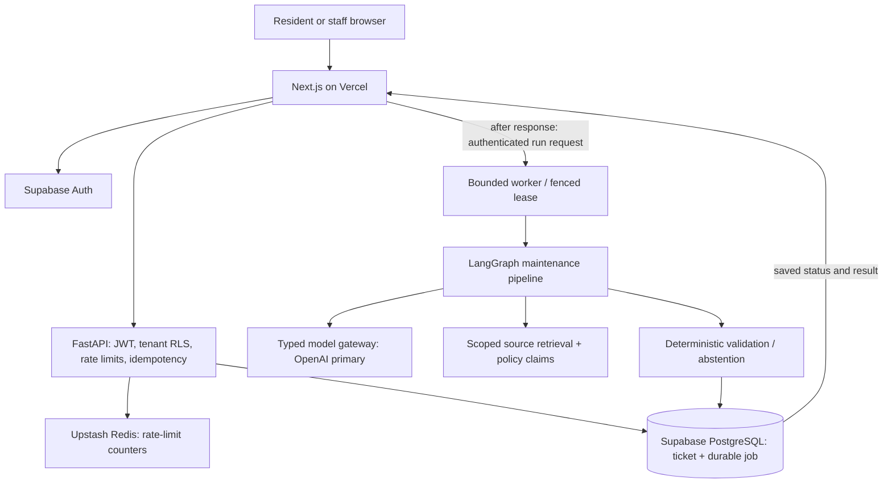

# Tento engineering deep dive

This is an implementation inventory, not a list of claimed integrations. **Live path** means wired into the deployed composition; **code + tests** means present but not necessarily active; **not integrated / not measured** means no production capability or benchmark is claimed.

## Architecture

The ticket, queued run and idempotency receipt commit before assessment begins. Next.js after() awaits an authenticated single-run worker request. Pending detail reads can recover eligible runs; protected Hobby cron recovers at most one job daily for the configured organization. This is not a continuously running queue consumer or an immediate unattended retry SLA.

## LLMs and model routing

Current deployment: **OpenAI gpt-4.1-mini**, from OPENAI_MODEL. The gateway has typed logical tiers; production uses deployment-owned OPENAI_MODEL_SMALL/MID/LARGE overrides, defaulting to OPENAI_MODEL. The current deployment retains GPT-4.1-mini across all tiers. There is no automatic small/large-model escalation in this composition.

| Active task | Logical tier | Current OpenAI model |
| --- | --- | --- |
| Intake normalization | Small | gpt-4.1-mini |
| Diagnosis | Mid | gpt-4.1-mini |
| Dispatch planning | Mid | gpt-4.1-mini |
| Policy audit | Small | gpt-4.1-mini |

If OpenAI configuration is absent and Anthropic key/model are configured, the composition selects Anthropic. This is configuration selection, not per-request failover after an OpenAI error. If neither is configured, the workflow fails safely. Stage preconditions can stop execution early, for example when policy evidence is missing.

The OpenAI adapter requests JSON-object output, then validates responses with Pydantic. Empty, refused or truncated responses fail safely. **Temperature is explicitly configured as 0 for the current deployment**. Routes validate finite values in [0,2]; omit the setting for models without sampling controls. Temperature 0 does not guarantee identical responses. max_completion_tokens is capped by the route (default 1,024). JSON mode is not treated as proof that a response matches the application schema.

Sources: [production composition](../services/brain/src/brain/production.py), [gateway and provider adapters](../services/brain/src/brain/gateway/client.py).

## Multi-agent orchestration and memory

The bounded LangGraph sequence is deterministic safety -> intake -> context/retrieval -> diagnosis -> dispatch planning -> independent policy audit -> deterministic terminal gate. Agents exchange typed state and do not receive arbitrary write-tool authority. Missing evidence or an invalid plan leads to abstention.

MemorySaver provides **per-run in-process checkpoints** with org/run thread identities and a serializer that revalidates typed handoffs. PostgreSQL persists durable jobs, steps, traces and results. A recovered lease restarts the bounded graph; this is not persistent conversational memory, cross-session personalization or mid-model-call crash recovery. Replayed attempts can incur additional provider usage.

Sources: [graph builder](../services/brain/src/brain/graph/builder.py), [typed state](../services/brain/src/brain/graph/state.py), [worker](../services/api/src/api/worker.py).

## RAG, context and embeddings

The live retrieval path uses PostgreSQL full-text lexical ranking, filtered by organization, jurisdiction, source status, authority and ticket effective time. Retrieved chunks carry immutable source versions and exact citation spans, joined to canonical policy claims. It is a source-grounded RAG-style workflow; **approved production policy documents are still required**. Synthetic knowledge/evaluation fixtures are not production evidence.

The tokenizer-backed context budgeter uses o200k_base and an **8,000-token envelope**, with whole-block inclusion/omission. This is an application budget, not the model's advertised context-window limit.

| Context slot | Token cap |
| --- | ---: |
| System/schema | 1,000 |
| Policy evidence | 1,600 |
| Unit/asset facts | 700 |
| Similar cases | 1,300 |
| Conversation summary | 500 |
| Current ticket | 600 |
| Output reserve | 2,300 |

The live composition supplies the inputs it has; the presence of a budget slot does not mean conversation summaries or similar-case memory are populated in production. Source-bearing blocks are not truncated to fit.

The verified-source import command uses **text-embedding-3-small, 1,536 dimensions**, with a tenant-scoped Upstash Redis embedding cache (24-hour TTL) when REDIS_URL is configured, an in-memory fallback when absent, and PostgreSQL halfvec storage. Redis outages degrade to misses; invalid vectors are rejected. Cache reuse never grants source eligibility. The live query path does not currently perform dense/hybrid search. **Hybrid RRF and BAAI/bge-reranker-v2-m3** implementations have independent tests; the cross-encoder is omitted from the minimal deployment runtime and is not active in the live retrieval path.

Sources: [live retrieval](../services/brain/src/brain/production.py), [budgeter](../services/brain/src/brain/context/budget.py), [importer](../services/brain/src/brain/ingest.py), [embeddings](../services/brain/src/brain/retrieval/embed.py), [hybrid](../services/brain/src/brain/retrieval/hybrid.py), [reranker](../services/brain/src/brain/retrieval/rerank.py).

## Databases, Supabase, Upstash and caching

- Supabase PostgreSQL stores organizations, tenancy records, tickets, agent runs, work orders, source documents/chunks, policy claims and audit receipts. pgvector/halfvec supports the source-ingestion/vector modules.
- Supabase Auth signs application identities. API verification uses public asymmetric JWKS; trusted application roles and organization/person IDs come from signed claims.
- Upstash TLS Redis supplies API rate limits and a separate tenant/model/content-scoped vector cache used by verified-source ingestion. It is not a semantic answer cache or an agent-memory store.
- PostgreSQL mutation idempotency replays the saved receipt and prevents duplicate ticket creation. Worker leases and deterministic work-order IDs protect execution effects.
- Static prompt prefixes and per-call cached-token usage are represented in the gateway. The Anthropic adapter sends an explicit ephemeral prefix-cache boundary. OpenAI cached-token usage is provider-reported; no cache-hit rate or savings benchmark is claimed.
- Redis embedding reuse has bounded values and expiry; the importer uses an in-process fallback only when Redis is not configured. Raw source text is not stored in the vector cache.

Sources: [API assembly](../services/api/src/api/main.py), [database/RLS context](../services/api/src/api/db.py), [rate limiter](../services/api/src/api/middleware/rate_limit.py), [idempotency](../services/api/src/api/middleware/idempotency.py).

## Guardrails, PII and prompt injection

The live path combines deterministic safety screening, regex-based PII redaction before model work, local shield/injection checks, explicit untrusted prompt context, no-write model capabilities, typed output validation and evidence-based decision checks. PII findings/audits use positions or digests rather than echoing original sensitive values. Optional Presidio/NLP assets are not included in the minimal runtime.

Prompt-injection detection is a signal, not the authority boundary. Server-controlled role checks, tenant predicates, transaction-local RLS, restricted runtime database roles and deterministic write gates enforce control. Models cannot grant themselves privileges. Browser credentials remain in HttpOnly cookies; production uses Secure/SameSite settings and same-origin mutation checks. Upstream redirects/caching are disabled for authenticated proxies. Secrets stay server-side and sanitized errors avoid reflecting database/provider exceptions.

These controls reduce risk; no claim is made that every injection or every PII form is detected. Managed shield-provider interfaces and a typed tool-authorizer exist as additional modules; no managed classifier service is claimed as deployed.

Sources: [PII](../services/brain/src/brain/guardrails/pii.py), [untrusted context](../services/brain/src/brain/guardrails/injection.py), [shield](../services/brain/src/brain/guardrails/shield.py), [JWT verification](../services/api/src/api/deps/auth.py), [RLS migration](../infra/migrations/0002_rls.sql).

## MCP: explicit integration status

The repository contains a typed MCP-facing tool vocabulary and fail-closed tool-grant module. **No MCP client/server transport is integrated into the production agent.** Connected GitHub/Vercel tools used during development/deployment are not application runtime MCP integrations. External vendor dispatch and notifications are not enabled.

Source: [tool authorization](../services/brain/src/brain/guardrails/tool_auth.py).

## Evaluation

Versioned offline fixtures cover retrieval, prompt injection and fair-housing cases. Retrieval reports accept actual runner rankings and calculate **Recall@5, Recall@10, MRR and nDCG@10**, with Git-revision provenance. A report is not generated by inventing rankings. The 50-query retrieval fixture and 40-case injection corpus are synthetic test inputs, not approved production policy sources.

Unit/contract tests cover typed model responses, refusal/failure handling, tenant boundaries, safety, retries, leases, idempotency and scripted workflows. CI includes real PostgreSQL integration plus Node/TypeScript/build/proxy checks. This is evidence of tested cases, not a published live RAG accuracy score or an exhaustive security certification.

Sources: [evaluation guide](../evals/README.md), [retrieval metrics](../evals/retrieval.py), [fair-housing evaluator](../evals/fair_housing.py), [.github workflows](../.github/workflows).

## Latency, speed, TTFT and cost

| Item | Current implementation / limit |
| --- | --- |
| Model-call elapsed latency | Recorded per attempt in llm_calls |
| Provider input/output/cached tokens | Recorded when returned by the provider |
| Gateway-call timeout in production | 15 seconds; retries and other stages add elapsed time |
| Output-token cap | 1,024 per default configured route |
| Graph recursion cap | 12 steps |
| Worker execution bound | 180 seconds |
| Job attempts / fencing lease | At most 3 attempts / 300-second lease |
| Web background worker request | 240-second timeout; 300-second route duration |
| Provider streaming / first-content latency | Measured at the worker; content-free model_metrics logs and benchmark reports |
| Intake and cache p50/p95 | Scoped synthetic benchmarks published in PART-2-GENAI.md; not production SLAs |
| Token-price estimate | Versioned GPT-4.1-mini standard rates, cached-input split and microdollar rounding |

TTFT means **time to first token** (sometimes written TIFT). The OpenAI production adapter uses streaming and times the first non-empty content event. It collects the full JSON privately and only releases schema-validated output to the graph. This metric is measured at the worker and does not represent browser-visible token delivery. Stream refusal, truncation, cancellation and missing final usage are explicit boundaries. Saved run/SSE snapshots remain workflow status, not a model-token stream.

The adapter estimates GPT-4.1-mini token cost using the versioned rate card in gateway/pricing.py. Total prompt tokens include cached tokens, so uncached and cached portions are charged once at their respective rates. Estimates round upward to whole microdollars and populate existing cost receipts. Structured worker logs include the price version; unknown models and missing usage have null price metadata rather than being described as free. Historical zero receipts are not backfilled. Interrupted calls may incur costs without final token usage; invoice totals also include infrastructure, tools and applicable charges.

[Part 2 methods, resume-safe scoped metrics and raw evidence](PART-2-GENAI.md). The checked-in baseline and final synthetic runs are separate observations, not a controlled causal experiment. No model migration, production reliability percentage, repair-time gain or retrieval-accuracy improvement is inferred from those runs.

Sources: [gateway receipts](../services/brain/src/brain/gateway/client.py), [worker limits](../services/api/src/api/worker.py), [web dispatch](../apps/web/lib/run-dispatch.ts), [hosting limitations](DEPLOYMENT.md).
